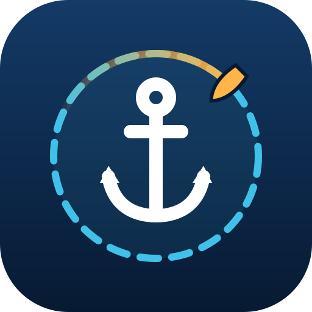

<p align="center"></p>

# Orca Core 2 Anchor Watch

An anchor alarm for a boat with an **Orca Core 2**, plus a read-only live reader for everything the Core publishes.
Runs on a Windows PC on the boat LAN; open it on an iPhone (or any browser) over HTTPS.
**Read-only on the Core**: it only listens to the streams the Orca app uses.

| Part | Start | Page |
|---|---|---|
| Anchor watch | `start_anchor_watch.cmd` | `https://<PC LAN address>:8766/` |
| Live reader (all Core values, AIS, NMEA 2000 devices) | `run.cmd` | `http://localhost:8765/` |

Not for navigation.

## Anchor watch

### Starting it (HTTPS, same setup as MasterVolt YMS)

Double-click `start_anchor_watch.cmd`. It:

1. runs `setup_local_https.ps1`, which issues this app's certificate from the existing **Mastervolt Local CA**
   (`C:\Temp\mastervoltproject\certs`, override with the `ANCHOR_CA_DIR` environment variable). An iPhone that
   already trusts that CA for MasterVolt YMS opens the anchor watch with no change. The script never creates a CA,
   never writes into the CA folder and never touches the Windows certificate store;
2. creates `.venv` on first run;
3. starts the server on the PC's private LAN address only (the same address MasterVolt YMS uses, written to
   `certs/bind-address.txt`), port 8766, and opens the page.

`run_anchor.cmd` still works and calls `start_anchor_watch.cmd`. The server refuses any address that is not localhost
or a private LAN address (10.x, 172.16-31.x, 192.168.x). There is no login: anyone on the boat network can open
the page and change the watch.

On the iPhone, *Share → Add to Home Screen* gives the app its own icon and a full-screen window. HTTPS also lets the
page keep the screen awake (Wake Lock) while sound is on.

### What it does

- **The watch runs on the PC, not in the browser.** Alarms are evaluated every second and beep through the PC
  speakers (setting *Beep on the watch PC*) even with no page open. Pages sound too after one tap on *Sound*, and a page
  raises its own alarm if it cannot reach the PC for 15 s (e.g. the phone dropped off Wi-Fi).
- **Alarms:** drag (outside the radius for *Drag confirm* seconds, default 10, which filters GPS jumps), GPS lost,
  no data from the Core, and optional minimum depth and maximum true wind. *Silence* mutes for 5 min; an alarm that
  clears and comes back sounds again.
- **Dropping:** *Dropping now* puts the anchor at the bow (GPS position + *GPS → bow roller* along the heading);
  *Already lying to it* puts it a given distance further ahead. *Move anchor on map* corrects it afterwards.
  The rode helper suggests a radius from rode length, depth and bow height.
- **Track:** the last 24 h (setting *Track kept*) is drawn on the map, older parts fainter. *Start new track* under
  the map deletes the recorded track and the max swing and starts afresh; the anchor watch itself carries on.
- **My MMSI** (Alarm settings): this boat's own AIS is never shown as a target. While it is empty, any target within
  10 m of the GPS is hidden and the page offers it as *Use as My MMSI*.
- **AIS:** targets within 600 m are drawn on the map; boats within 120 m (or twice the radius) are kept in view.
  The *AIS nearby* tile says so when the AIS feed is down.
- **Position source:** the Core's own position (source 254) is **frozen while the Core flags the boat as
  stationary** (`navigation.motion.254.stationary = 1`); it did not move for minutes while the receivers did.
  The watch therefore uses the raw receivers in order `4,127,3` (setting *GPS sources*) with failover, and uses 254
  only while the Core says the boat is moving.
- Anchor, settings, track and log are kept in `anchor_state.json`, so a restart resumes the watch.

### Map

- **Layers:** *Chart* (OpenStreetMap), *Satellite* (Esri World Imagery) or *Plain*, plus OpenSeaMap overlays:
  *Seamarks* (buoys, beacons, lights) and *Depth* (crowd-sourced soundings from other boats' tracks, coloured red 0 m
  to green 10 m or more, plus coarse contours; sparse, and only where someone has logged). None of these are
  official charts. The Orca Core holds no chart data (the Orca app keeps its licensed charts on the phone).
- **Offline:** the PC fetches tiles on demand and keeps them in `tile_cache/` (refreshed after 30 days; the old copy
  is used when there is no internet). Any area viewed while online stays available offline. Nothing is
  bulk-downloaded, in line with the OpenStreetMap tile policy. With no internet and no cached tiles, the circle, track
  and boats still show on a plain background. `--tile-cache <folder>` moves the cache.
- Dark and night (red) display modes tint the map too; seamark colours are never inverted.
- Leaflet 1.9.4 is included in `static/vendor/leaflet/` (checked against the cdnjs SHA-512 hashes; BSD-2-Clause,
  © Vladimir Agafonkin), so the page needs no CDN.

### Command line

```
.venv\Scripts\python.exe anchor_watch.py [--host 192.168.1.124] [--bind 127.0.0.1] [--port 8766]
    [--certfile certs\server-cert.pem --keyfile certs\server-key.pem] [--state anchor_state.json]
    [--tile-cache tile_cache] [--no-ais]
```

Without `--certfile/--keyfile` it serves plain HTTP (development only; phones then get no wake lock).

## Live reader

Double-click `run.cmd` (creates `.venv` on first run), or:

```
.venv\Scripts\python.exe orca_reader.py [--host 192.168.1.124] [--record] [--interval 200] [--no-ais]
```

- `--record [folder]` appends every raw message to `recordings/<date>_sensors.jsonl` / `_ais.jsonl`
  (roughly 0.5 MB per minute with the default 200 ms interval).
- `--bind 0.0.0.0` makes the page reachable from other devices on the LAN (default: this PC only).
- `GET /api/state` returns the decoded values as JSON; `GET /api/raw` returns the raw key → value map.

## Orca Core 2 protocol (found by capturing the iPhone app, Core firmware 1.21.0)

Orca publishes no third-party API; this came from capturing the Orca app's own traffic.

| What | Where |
|---|---|
| Live sensors | `ws://<core>:8089/v1/sensors/delta?interval=200&ns=%5E(?!.*(ais))&enableUnknownSources` |
| AIS targets | `ws://<core>:8089/v1/sensors/delta?interval=5000&ns=ais&enableUnknownSources` |
| NMEA 2000 devices | `GET http://<core>:8088/v1/devices` |
| Other read-only GETs the app uses | `:8088/v1/sources?name`, `/v1/settings`, `/v1/nmea2000/status`, `/v1/logbook`, `:9081/v1/radars?active`, `:8080/info` |

A stream starts with one `"event_type":"full"` message, followed by `"delta"` messages holding only changed values
plus `values_age` (ms since the Core last updated each value). Keys are `<group>.<N2K source address>.<field>`,
e.g. `navigation.heading.254.heading`; wind adds an instance (`environment.wind.254.2.angle`, 2 = apparent).
Source 254 is the Core's own fused value. Units are SI: radians, rad/s, m/s, metres, volts.
Text fields are passed through unescaped: an AIS destination containing a backslash (seen: `IBIZA\FORMENTERA`)
makes the message invalid JSON, so `parse_message` repairs lone backslashes before giving up.

**Not used on purpose** (they change state on the Core): `PUT /v1/sources`, `POST :9001/imu/calibration`,
the `/v1/sync` WebSocket, and the firmware update page on port 8090.

The packet captures the protocol was worked out from stay in `captures/` locally and are not in the repository.

## Tests

```
.venv\Scripts\python.exe -m unittest test_anchor_watch
```

Simulated Core data, no network: drag, GPS jumps, the frozen Core position, receiver failover, GPS and Core loss,
silence, restart, depth/wind, tile cache, the JSON repair, My MMSI and *Start new track*.

Release history: [CHANGELOG.md](CHANGELOG.md).
